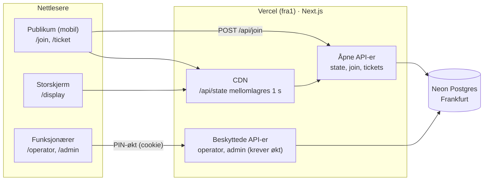

# Arkitektur

Én Next.js-app på Vercel med én Postgres-database hos Neon. Nettleseren snakker bare med appens egne API-ruter, aldri med databasen.

## 1. Oversikt

## 2. Datamodell

Definert i `db/migrations/001_init.sql` og `002_robust_join.sql`.

| Tabell | Viktige felt | Regler |
| --- | --- | --- |
| `stations` | `id` (A/B/C), `description`, `active`, `join_key`, `next_number`, `generation` | `join_key` er hemmelig. `generation` økes ved nullstilling. |
| `tickets` | `id` (uuid), `station`, `number`, `generation`, `status`, `created_at`, `called_at`, `finished_at`, `request_id`, `ip_hash` | Unik på (`station`, `generation`, `number`) og på (`station`, `generation`, `request_id`). Maks én `called` per stasjon (delvis unik indeks). `ip_hash` er en HMAC av nettverket, aldri selve IP-adressen. |
| `queue_actions` | `station`, `kind` (next/skip), `finished_ticket`, `called_ticket`, `undone` | Logg som gjør «Angre siste» mulig i flere steg. |
| `settings` | `pin_hash`, `pin_version`, `session_secret` | Én rad (`id = 1`). |
| `rate_limits` | `key`, `count`, `window_start` | Forsøksgrenser for PIN og nye lapper. |
| `schema_migrations` | `version` | Hvilke migreringer som er kjørt. |

Status for en lapp: `waiting` → `called` → `done` eller `skipped`. En `skipped` kan settes tilbake til `waiting` av operatør.

## 3. Hvorfor nummer aldri dobles

`GET /api/state` leser alle tabeller i ett øyeblikksbilde (`repeatable read`), så en samtidig nullstilling aldri gir et blandet svar.

Alle endringer skjer i `src/lib/queue.ts` i én transaksjon som starter med `SELECT … FROM stations WHERE id = $1 FOR UPDATE`. Samtidige skann på samme stasjon står da i kø i databasen, og hver får neste nummer. Unik-regelen på (`station`, `generation`, `number`) er en ekstra sikring. Testet med 200 samtidige skann i `tests/integration/queue.test.ts`.

Samme lås brukes for NESTE, Hopp over, Angre, Sett tilbake og Nullstill, så to operatører på samme stasjon aldri kan kalle samme person.

## 4. API

| Metode og sti | Tilgang | Svar |
| --- | --- | --- |
| `GET /api/state` | Åpen, CDN 1 s | Alle stasjoner: `description`, `active`, `generation`, `nextNumber`, `current`, `waiting[]`, `skipped[]` |
| `POST /api/join` `{station, key, existingTicketId?, requestId?}` | Åpen, nøkkel + forsøksgrenser (300/min per nettverk, 20 feil nøkler/min, maks 100 ventende per nettverk per stasjon) | `{ticketId, reused}` eller feilkode. Samme `requestId` gir samme lapp. |
| `GET /api/tickets/:id` | Åpen (ukjent UUID) | `{station, number, generation, status, ahead, description}` |
| `POST /api/auth/login` `{pin}` | Åpen, 5 forsøk per 15 min per IP og 100 feil totalt per 15 min | Setter cookie `kolapp_session` |
| `POST /api/auth/logout` | Åpen (Origin-sjekk) | Sletter cookie |
| `GET /api/operator/:station` | Økt | `{current, next[5], waitingCount, skipped[], canUndo, lastActionId, active}` |
| `POST /api/operator/:station/next\|skip\|undo\|requeue` | Økt | Ny operatørvisning. `next`/`skip` tar `expectedCurrentId`: avviker den fra lappen som faktisk betjenes, gjøres ingenting (vern mot dobbelt trykk). `undo` tar `expectedActionId` på samme måte. `requeue` tar `ticketId`. |
| `GET /api/admin/stations` | Økt | Stasjoner med `joinUrl` og `qrSvg`, og `pinIsDefault` |
| `POST /api/admin/stations/:station/reset\|activate\|deactivate\|rotate-key\|description\|remove-waiting` | Økt | `{ok: true}`. `remove-waiting` tar `{from, to}` og svarer `{removed}`. |
| `PUT /api/admin/pin` `{pin}` | Økt | Ny PIN (6–12 sifre), alle andre logges ut |
| `GET /api/health` | Åpen | `{ok, version, commit, db, migration}`, 503 hvis databasen ikke svarer |

Feilsvar har alltid formen `{error: "<kode>", message: "<norsk tekst>"}`. Kodene står i `src/lib/texts.ts`.

Alle POST/PUT krever at `Origin` matcher vertsnavnet (CSRF-vern). Økter fornyes automatisk ved bruk (etter 1 time), og varer 24 timer.

Feil i databasen: død tilkobling ved lesing prøves én gang til. Lås- eller tidsgrense gir `busy` (503) med vennlig tekst. Alle transaksjoner har `lock_timeout` 5 s og `statement_timeout` 10 s.

## 5. Flyt for en kølapp

1. QR åpner `/join?station=A&key=…`. Siden sender `POST /api/join` med eventuell lagret lapp-id fra `localStorage` (`kolapp_A`).
2. Serveren sjekker nøkkel og om stasjonen er åpen, og gjenbruker en aktiv lapp eller lager ny.
3. Nettleseren lagrer id-en og går til `/ticket/:id` (`replace`, så nøkkelen ikke ligger i historikken).
4. `/ticket/:id` henter lappen én gang fra `/api/tickets/:id`, og følger deretter den delte `GET /api/state` hvert 3. sekund (hvert 15. sekund etter «Ferdig», i tilfelle en operatør angrer).
5. `deriveTicket()` i `public-state.ts` regner ut status og antall foran fra den delte køstatusen.
6. Når status blir `called`: grønn skjerm, vibrering (Android) og «Din tur!» i fanetittelen.

## 6. Budsjett for Vercel Hobby

Grensene per måned: 1 000 000 CDN-forespørsler, 1 000 000 funksjonskall og 4 timer Active CPU. Over grensen pauses prosjektet i 30 dager.

Anslag for én konferansedag (8 timer), 300 brukere som i snitt har lappen åpen i 20 minutter, 3 operatører og 1 storskjerm:

| Kilde | Regnestykke | CDN-forespørsler | Funksjonskall |
| --- | --- | --- | --- |
| Kølapper | 300 × 20 min × 20 per min | 120 000 | – (deles via CDN) |
| `/api/state` bak CDN | maks ca. 1 per sekund i 8 t | – | 29 000 |
| Første henting av lapp | 300 × ca. 2 | 600 | 600 |
| Storskjerm | 8 t × 1 200 per time | 10 000 | – (deles via CDN) |
| Operatører | 3 × 8 t × 1 200 per time | 29 000 | 29 000 |
| Sideinnlastinger og filer | 300 × ca. 30 | 9 000 | 1 000 |
| **Sum** | | **ca. 170 000** | **ca. 60 000** |

Det gir god margin, også for flere dager i samme måned. Neon Free (100 CU-timer) brukes med ca. 3 CU-timer per dag.

Det som holder tallene nede:
- Kølapper og storskjerm leser bare den delte `/api/state`, som mellomlagres på CDN (`CDN-Cache-Control: s-maxage=1`).
- Polling pauser når fanen er skjult (låst mobil), går ned til hvert 15. sekund når lappen er ferdig, og stopper når lappen ikke finnes.
- Fonter og ikoner ligger i appen, så det går ingen kall til eksterne tjenester.

## 7. Region og ytelse

Funksjoner kjører i `fra1` (Frankfurt, satt i `vercel.json`), nær Neon i `eu-central-1`. Neon Free sover etter 5 minutter uten trafikk. Første kall etter det tar under ett sekund ekstra.
