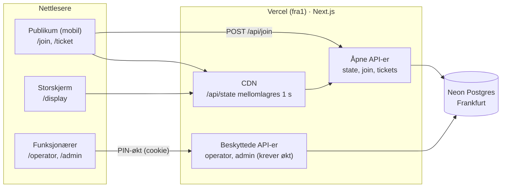

# Arkitektur

Én Next.js-app på Vercel med én Postgres-database hos Neon. Nettleseren snakker bare med appens egne API-ruter, aldri med databasen.

## 1. Oversikt

## 2. Datamodell

Definert i `db/migrations/` (001–007).

| Tabell | Viktige felt | Regler |
| --- | --- | --- |
| `stations` | `id` (én bokstav A–Z), `name` (maks 40), `color` (palett-navn eller `#rrggbb`), `sort_order`, `archived_at`, `description`, `active`, `closed_message`, `join_key`, `next_number`, `generation` | `join_key` er hemmelig. `generation` økes ved nullstilling. `closed_message` er offentlig, men vises bare mens stasjonen er stengt. Maks 12 aktive (`archived_at IS NULL`). Slettes aldri. |
| `tickets` | `id` (uuid), `station`, `number`, `generation`, `status`, `created_at`, `called_at`, `finished_at`, `request_id`, `ip_hash` | Unik på (`station`, `generation`, `number`) og på (`station`, `generation`, `request_id`). Maks én `called` per stasjon (delvis unik indeks). `ip_hash` er en HMAC av nettverket, aldri selve IP-adressen. |
| `queue_actions` | `station`, `kind` (next/skip), `finished_ticket`, `called_ticket`, `undone` | Logg som gjør «Angre siste» mulig i flere steg. |
| `settings` | `pin_hash`, `pin_version`, `session_secret`, `vapid_public`, `vapid_private` | Én rad (`id = 1`). `vapid_private` er hemmelig. |
| `rate_limits` | `key`, `count`, `window_start` | Forsøksgrenser for PIN og nye lapper. |
| `site_config` | `display_title`, `audio_mode` (default/custom/off), `audio_volume`, `audio_media_id`, `event_name`, `logo_media_id`, `primary_color` (`#rrggbb`), `display_background` (dark/light), `font_display`, `font_body`, `push_enabled` (standard av) | Én rad. Innstillinger fra admin. Nye innstillinger legges til som kolonner med standard = dagens oppførsel. |
| `push_subscriptions` | `ticket_id` → `tickets` (slettes med lappen), `endpoint`, `p256dh`, `auth`, `last_kind` (next/called/skipped) | Ett abonnement per lapp og nettleser. `last_kind` hindrer dobbel utsending. |
| `media` | `kind` (audio/logo), `mime`, `bytes`, `size`, `sha256` | Opplastede filer. Filtype sjekket på innhold. Serveres som `/api/media/<sha256>`. Filer ingen peker på (verken som lyd eller logo) slettes. |
| `schema_migrations` | `version` | Hvilke migreringer som er kjørt. |

Status for en lapp: `waiting` → `called` → `done` eller `skipped`. En `skipped` kan settes tilbake til `waiting` av operatør.

## 3. Hvorfor nummer aldri dobles

`GET /api/state` leser alle tabeller i ett øyeblikksbilde (`repeatable read`), så en samtidig nullstilling aldri gir et blandet svar.

Alle endringer skjer i `src/lib/queue.ts` i én transaksjon som starter med `SELECT … FROM stations WHERE id = $1 FOR UPDATE`. Samtidige skann på samme stasjon står da i kø i databasen, og hver får neste nummer. Unik-regelen på (`station`, `generation`, `number`) er en ekstra sikring. Testet med 200 samtidige skann i `tests/integration/queue.test.ts`.

Samme lås brukes for NESTE, Hopp over, Angre, Sett tilbake og Nullstill, så to operatører på samme stasjon aldri kan kalle samme person.

## 4. API

| Metode og sti | Tilgang | Svar |
| --- | --- | --- |
| `GET /api/state` | Åpen, CDN 1 s | Aktive stasjoner i admin-rekkefølge: `id`, `name`, `color`, `description`, `active`, `closedMessage` (tom når åpen), `generation`, `nextNumber`, `current`, `waiting[]`, `skipped[]` |
| `POST /api/join` `{station, key, existingTicketId?, requestId?}` | Åpen, nøkkel + forsøksgrenser (300/min per nettverk, 20 feil nøkler/min, maks 100 ventende per nettverk per stasjon) | `{ticketId, reused}` eller feilkode. Samme `requestId` gir samme lapp. |
| `GET /api/tickets/:id` | Åpen (ukjent UUID) | `{station, number, generation, status, ahead, description, stationName, color}` |
| `POST`/`DELETE /api/tickets/:id/push` `{endpoint, keys}` / `{endpoint}` | Åpen med lapp-id, Origin-sjekk, 120/min per nettverk | Slår push-varsel på/av for lappen. Bare kjente push-tjenester godtas. 409 `push_disabled` når push er av. |
| `GET /ticket/:id/manifest.webmanifest` | Åpen | Manifest med `start_url` = lappen (Hjem-skjerm på iPhone) |
| `POST /api/auth/login` `{pin}` | Åpen, 5 forsøk per 15 min per IP og 100 feil totalt per 15 min | Setter cookie `kolapp_session` |
| `POST /api/auth/logout` | Åpen (Origin-sjekk) | Sletter cookie |
| `GET /api/operator/:station` | Økt | `{current, next[5], waitingCount, skipped[], canUndo, lastActionId, active, closedMessage}` |
| `POST /api/operator/:station/next\|skip\|undo\|requeue` | Økt | Ny operatørvisning. `next`/`skip` tar `expectedCurrentId`: avviker den fra lappen som faktisk betjenes, gjøres ingenting (vern mot dobbelt trykk). `undo` tar `expectedActionId` på samme måte. `requeue` tar `ticketId`. |
| `GET /api/admin/stations` | Økt | Aktive stasjoner med `name`, `color`, `joinUrl` og `qrSvg`, `archived[]` og `pinIsDefault` |
| `POST /api/admin/stations` `{name?, color?}` | Økt | Ny stasjon (neste ledige bokstav). 409 `station_limit` / `no_free_station`. |
| `POST /api/admin/stations/:station/meta\|move-up\|move-down\|archive\|restore\|reset\|activate\|deactivate\|closed-message\|rotate-key\|description\|remove-waiting` | Økt | `{ok: true}`. `meta` tar `{name?, color?}`. `archive` gir 409 `station_not_empty` hvis noen venter eller er kalt. `restore` gir tom kø og ny nøkkel. `deactivate` tar valgfri `{message}` og `closed-message` tar `{message}` (maks 80 tegn). `remove-waiting` tar `{from, to}` og svarer `{removed}`. |
| `PUT /api/admin/pin` `{pin}` | Økt | Ny PIN (6–12 sifre), alle andre logges ut |
| `GET /api/health` | Åpen | `{ok, version, commit, db, migration}`, 503 hvis databasen ikke svarer |
| `GET /api/config` | Åpen, CDN 5 s | `{audio: {mode, volume, url}, display: {title}, brand: {eventName, logoUrl, primaryColor, displayBackground, fontDisplay, fontBody}, push: {enabled, publicKey}}` – offentlige innstillinger, aldri hemmeligheter |
| `GET /api/display/qr?station=A,C&t=<token>` | Åpen med signert token, aldri mellomlagret | `{qr: {A: "<svg>", C: "<svg>"}}`. Feil eller utdatert token: 403 `display_link_expired`. |
| `GET /api/admin/display-token?station=A,C` | Økt | `{token}` for skjermlenke med QR |
| `GET /api/media/<sha256>` | Åpen, CDN for alltid | Filen, `immutable` mellomlagring (også `CDN-Cache-Control`, så Vercel-CDN-et deler den) og `sandbox`-CSP |
| `GET`/`PUT /api/admin/config` | Økt | Les/endre innstillinger (`audioMode`, `audioVolume`, `displayTitle` maks 80 tegn, `pushEnabled`). GET har også `pushSubscribers`. |
| `PUT`/`DELETE /api/admin/branding` | Økt | Lagre utseende (`eventName` maks 60, `primaryColor` hex, `displayBackground`, `fontDisplay`, `fontBody` fra fontlisten) / tilbakestill til standard (fjerner også logo). Svarer med innstillingene. |
| `POST`/`DELETE /api/admin/logo` | Økt | Last opp (multipart `file`, PNG/JPEG/WebP/SVG, maks 512 kB, sjekket på innhold, SVG-vern) / fjern logo |
| `POST`/`DELETE /api/admin/audio` | Økt | Last opp (multipart `file`, maks 2 MB, sjekket på innhold) / fjern egen lyd |

Feilsvar har alltid formen `{error: "<kode>", message: "<norsk tekst>"}`. Kodene står i `src/lib/texts.ts`.

Alle POST/PUT krever at `Origin` matcher vertsnavnet (CSRF-vern). Økter fornyes automatisk ved bruk (etter 1 time), og varer 24 timer.

Feil i databasen: død tilkobling ved lesing prøves én gang til. Lås- eller tidsgrense gir `busy` (503) med vennlig tekst. Alle transaksjoner har `lock_timeout` 5 s og `statement_timeout` 10 s.

## 5. Flyt for en kølapp

1. QR åpner `/join?station=A&key=…`. Siden sender `POST /api/join` med eventuell lagret lapp-id fra `localStorage` (`kolapp_A`).
2. Serveren sjekker nøkkel og om stasjonen er åpen, og gjenbruker en aktiv lapp eller lager ny.
3. Nettleseren lagrer id-en og går til `/ticket/:id` (`replace`, så nøkkelen ikke ligger i historikken).
4. `/ticket/:id` henter lappen én gang fra `/api/tickets/:id`, og følger deretter den delte `GET /api/state` hvert 3. sekund (hvert 15. sekund etter «Ferdig», i tilfelle en operatør angrer).
5. `deriveTicket()` i `public-state.ts` regner ut status og antall foran fra den delte køstatusen.
6. Når status blir `called`: grønn skjerm, vibrering (Android) og «Din tur!» i fanetittelen.

## 5b. Lydsignal

- Lydsiden `/audio` og storskjermen med `?sound=1` leser den samme delte `/api/state` som før, og spiller lyd når et nytt nummer kalles (`detectNewCalls()` i `src/lib/announce.ts`).
- Lydsiden henter i en **Web Worker** (`src/app/audio/poller.worker.ts`), så den lytter også i bakgrunnen. Den bruker ingen ekstra kvote utover én «skjerm».
- Lyd spilles med Web Audio (`src/lib/sound.ts`): standardlyden lages i koden, egen lyd hentes fra `/api/media/…` og dekodes én gang. Volum fra `/api/config`.
- Nettlesere krever ett klikk før lyd: «Start lydsignal» / «Klikk for å slå på lyd».

## 5c. Skjermer

- `/display` leser skjermvalg fra adressen med `parseDisplayOptions()` (`src/lib/display-options.ts`, ren og testet). Lenkebyggeren i admin bruker `buildDisplayQuery()` som utelater standardverdier.
- Selve skjermen er komponenten `DisplayBoard` (`src/components/DisplayBoard.tsx`), uten datahenting. Den brukes både av `/display` og av forhåndsvisningen i admin (et 1600×900-felt som skaleres ned; derfor `wide`-utgave uten skjermbredde-klasser). Én stasjon bruker container-enheter (`cqw`/`cqh`) så nummeret fyller skjermen også i forhåndsvisningen. Ikke iframe, så `frame-ancestors 'none'` beholdes.
- Overskriften hentes fra `/api/config` (hvert 15. s). Stengt stasjon og melding kommer fra `/api/state`.
- **QR på storskjermen:** token = HMAC-SHA256(serverhemmelighet, `qr:<sorterte stasjoner>:<deres nøkler>`), 32 tegn base64url (`src/lib/display-token.ts`). Tokenet dekker utvalget i lenken, så én lenke med flere stasjoner trenger ett token. `/api/display/qr` sjekker det i konstant tid og svarer bare med SVG. «Bytt nøkkel» på en av stasjonene gjør tokenet ugyldig. Skjermen henter QR hvert 60. sekund. Lenke og QR lages av samme hjelper som admin (`src/lib/join-link.ts`).

## 5d. Utseende

- `src/lib/branding.ts` (ren): fontliste, standardutseende og `brandingVars()` som gir CSS-variablene `--brand-primary`, `--brand-on-primary`, `--brand-font-display` og `--brand-font-body`. `globals.css` bruker dem med dagens verdier som reserve.
- Rotlayouten leser utseendet med `getBranding()` (`src/lib/branding-server.ts`): Next.js datacache med tag `branding` og 5 minutters sikkerhetsnett. Ingen databasekall per besøkende. Databasefeil gir standardutseende og mellomlagres ikke.
- Statiske sider (`/`, `/display`, `/join`, `/audio`) er ISR: de bygges med utseendet og fornyes når admin lagrer (`revalidateTag` + `revalidatePath("/", "layout")`) eller senest etter 5 minutter.
- Klientkomponenter får navn og logo via `BrandingProvider`/`useBranding()`. Storskjermen henter i tillegg utseendet fra `/api/config` hvert 15. sekund og setter CSS-variablene selv, så den slipper å lastes på nytt.
- Storskjermbakgrunnen er standard for `/display`; `theme=` i lenken overstyrer (`hasThemeParam()`).
- Arrangementsnavnet og storskjermens overskrift (`display_title`, v1.3) er to felt. Ved endring av navnet foreslår admin å oppdatere overskriften til «<navn> · Køstatus» hvis den ikke er egendefinert.
- Fonter ligger i appen (`@fontsource`). Alle `@font-face` lastes som CSS, men nettleseren laster bare ned filene til fontene som brukes.

## 5e. Push-varsel

- Standard Web Push (VAPID) via `web-push`. Ingen ekstern varslingstjeneste: meldingene går til nettleserens egen push-tjeneste (Google, Mozilla, Apple, Microsoft), kryptert (RFC 8291).
- Service worker `public/sw.js` viser varselet (`renotify`, «din tur» blir stående) og åpner kølappen ved trykk. Ingen side-mellomlagring.
- Kølappen henter `/api/config` én gang. `push.enabled` = bryteren i admin og at nøkler finnes. `PushPrompt` (`src/app/ticket/[id]/PushPrompt.tsx`) viser knapp, iPhone-veiviser eller ingenting etter `detectPushSupport()` (`src/lib/push-support.ts`).
- iPhone: push virker bare fra Hjem-skjerm. Hver lapp har eget manifest (`/ticket/<id>/manifest.webmanifest`, `start_url` = lappen), så Hjem-skjerm-appen åpner riktig lapp selv om den har egen lagring.
- **Utsending:** operatørhandlinger (og «Fjern ventende lapper») kaller `notifyStation(stasjon)` i `after()` – etter at svaret er sendt. Den rydder gamle abonnementer, regner ut hvem som skal ha hva (`planNotifications()`), reserverer hvert varsel med en betinget `UPDATE … last_kind` (aldri dobbelt, heller ikke ved samtidige kjøringer) og sender. 404/410 sletter abonnementet; midlertidig feil prøves én gang til og frigir ellers reservasjonen, så neste handling prøver igjen.
- Bekreftelsesvarsel sendes rett etter at gjesten slår på, så hun ser at det virker.

## 5f. Stasjoner

- Stasjoner er rader i `stations` (v1.6). Koden er én bokstav A–Z, tildeles automatisk (`nextFreeStationId`) og gjenbrukes aldri – heller ikke fra arkiverte – fordi den står i QR og på lapper.
- Opprettelse, gjenoppretting og rekkefølge låses med `pg_advisory_xact_lock`, så samtidige trykk aldri gir samme bokstav eller over 12 aktive.
- Arkivering skjer i stasjonens vanlige lås og krever at ingen venter eller er kalt. Arkiverte stasjoner filtreres bort i `/api/state`, admin, skjermlenker og skann (`invalid_station`). Gjenoppretting gir ny nøkkel og ny generasjon (tom kø).
- Farger: `src/lib/stations.ts`. Paletten (12) har faste Tailwind-toner; A/B/C er sky/violet/emerald som før. Egen hex får lys bakgrunn og kantlinje ved blanding, og tekstfarger justert til minst 4,5:1 mot hvitt (kølapp) og svart (storskjerm). Fargene settes som CSS-variabler (`stationVars`) og brukes med klassene i `ST`.
- Storskjermen: `displayColumns()` – 1, 2–3 (som før), 4, 5–8 (fire kolonner) og 9–12 (seks kolonner), med mindre nummer ved mange.
- Ukjent stasjon i API-et gir `StationNotFoundError` → `invalid_station` (400) i stedet for serverfeil.

## 6. Budsjett for Vercel Hobby

Grensene per måned: 1 000 000 CDN-forespørsler, 1 000 000 funksjonskall og 4 timer Active CPU. Over grensen pauses prosjektet i 30 dager.

Anslag for én konferansedag (8 timer), 300 brukere som i snitt har lappen åpen i 20 minutter, 3 operatører og 1 storskjerm:

| Kilde | Regnestykke | CDN-forespørsler | Funksjonskall |
| --- | --- | --- | --- |
| Kølapper | 300 × 20 min × 20 per min | 120 000 | – (deles via CDN) |
| `/api/state` bak CDN | maks ca. 1 per sekund i 8 t | – | 29 000 |
| Første henting av lapp | 300 × ca. 2 | 600 | 600 |
| Storskjerm | 8 t × (1 200 status + 240 konfig) per time | 11 500 | – (deles via CDN). Med QR: + 60 per time (480 funksjonskall) |
| Operatører | 3 × 8 t × 1 200 per time | 29 000 | 29 000 |
| Lydsider (2 stk) | 2 × 8 t × (1 200 status + 240 konfig) per time | 23 000 | – (deles via CDN) |
| Sideinnlastinger og filer | 300 × ca. 30 | 9 000 | 1 000 (inkl. fornying av statiske sider, maks ca. 12 per side per time) |
| Push (når på) | 300 × (1 på + ca. 3 varsler) | – | ca. 300 (+ ca. 900 utgående kall, ingen egne funksjonskall) |
| **Sum** | | **ca. 197 000** | **ca. 60 000** |

Det gir god margin, også for flere dager i samme måned. Neon Free (100 CU-timer) brukes med ca. 3 CU-timer per dag.

Det som holder tallene nede:
- Kølapper og storskjerm leser bare den delte `/api/state`, som mellomlagres på CDN (`CDN-Cache-Control: s-maxage=1`).
- Polling pauser når fanen er skjult (låst mobil), går ned til hvert 15. sekund når lappen er ferdig, og stopper når lappen ikke finnes.
- Fonter og ikoner ligger i appen, så det går ingen kall til eksterne tjenester.

## 7. Region og ytelse

Funksjoner kjører i `fra1` (Frankfurt, satt i `vercel.json`), nær Neon i `eu-central-1`. Neon Free sover etter 5 minutter uten trafikk. Første kall etter det tar under ett sekund ekstra.
